# 透写台 Trace Light


**中文** · [English](#english)

把一张纸放在桌上，用手把虚拟纸框对上它的四个角；挑一张画，引导线就一步一步投在你的纸上，你用真铅笔跟着描。适用于 PICO OS 6（Swan）。


## 能做什么

- **任何尺寸的纸**：A4、信纸、便签、速写本都行。捏一下放下纸框，把四个角拖到纸角（中间的把手可以整体移动，手柄摇杆左右转动），点「对好了」就开始画。
- **6 套 × 5 张描摹课，由简到难**：线条练习 · 简笔动物 · 花草 · 人物头像 · 建筑速写 · 汉字笔画。
- **一步一步出现**：当前这一步是亮蓝色，前面的步变淡，后面的还没出来；一个橙色的小点按笔顺把这一步画给你看。
- **自由画**：整张纸都是你的，可以打开 20 mm 网格把握比例。
- **注视 + 捏合**或**手柄射线 + 扳机**操作，面板立在纸的左边（左手用户在右边），坐着就够得着，不用走过去。
- 全离线、无账号、无网络、无相机权限；中英双语。

## 截图

> 以下截图来自 PICO 模拟器（虚拟房间 + 调试命令造的桌面），不是真实头显画面，也不是真实手势录像。

| 对纸的四个角 | 课程库 |
|---|---|
| 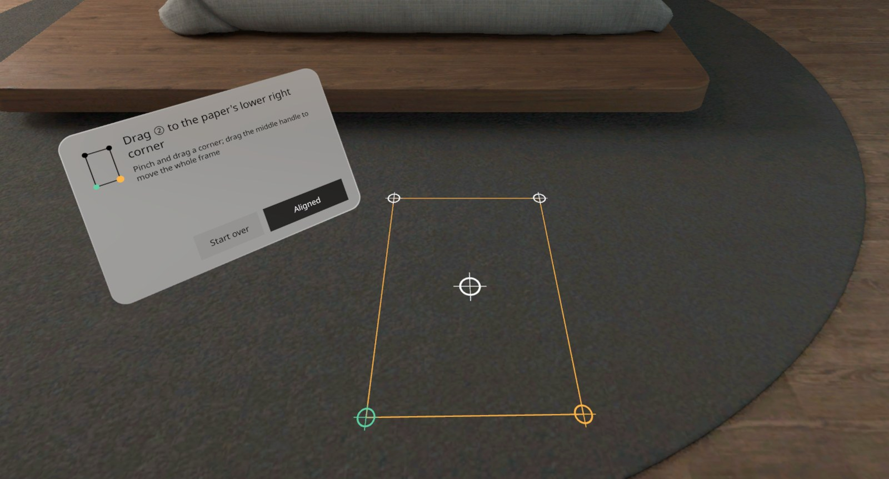 | 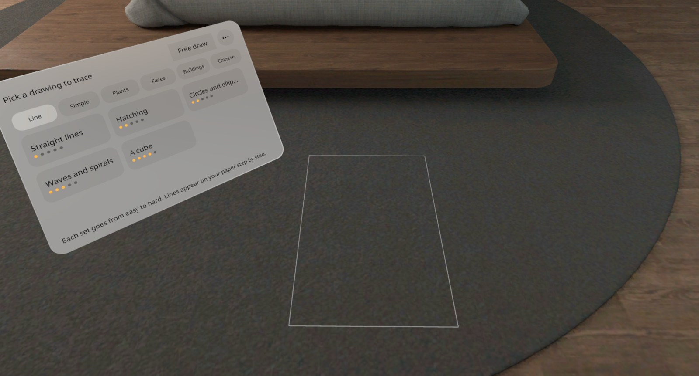 |
| **描：小猫第 3 步，橙点示范笔顺** | **描：向日葵最后一步** |
| 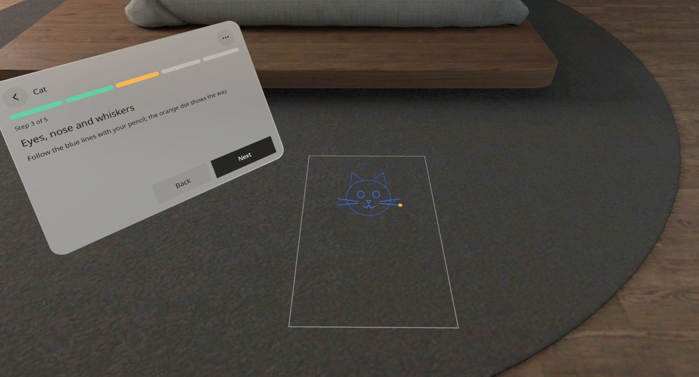 | 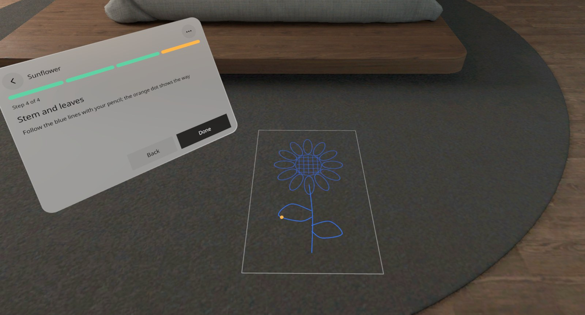 |
| **画完了** | **自由画 + 网格** |
| 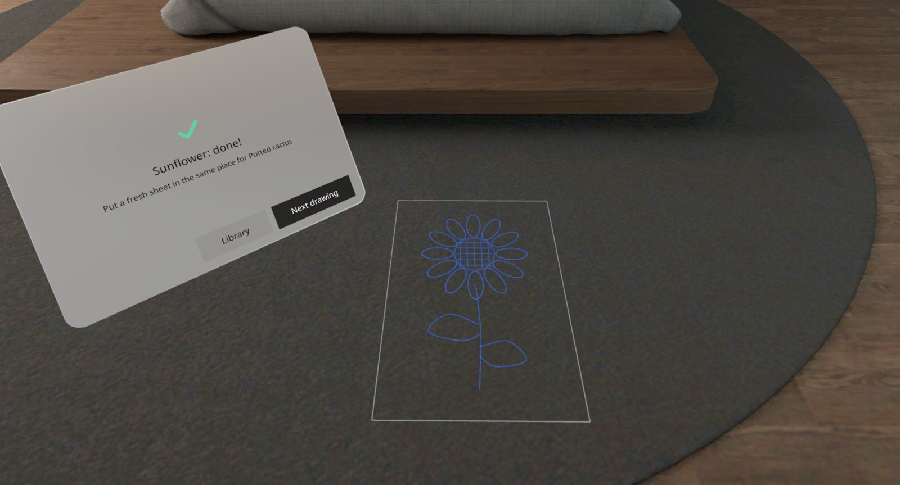 | 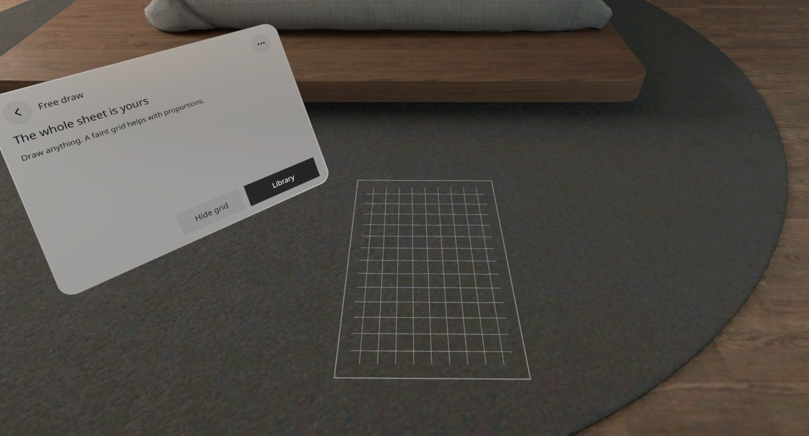 |

课程线稿一览（每套 5 张，蓝 → 绿 = 第一步 → 最后一步）：

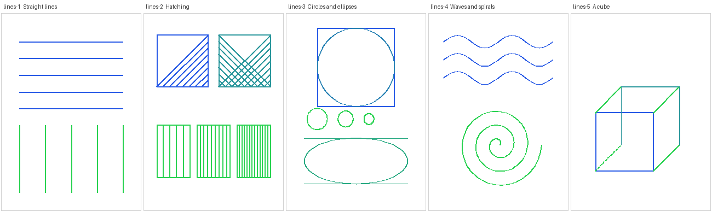
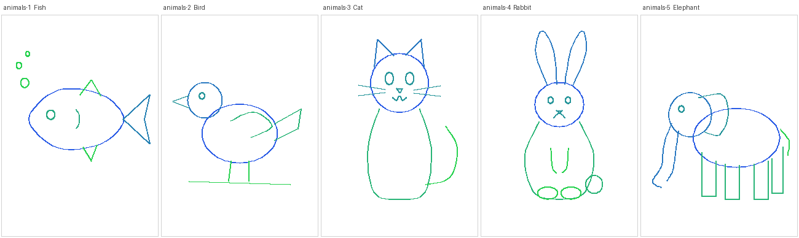
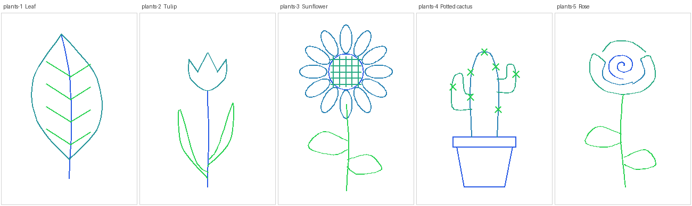
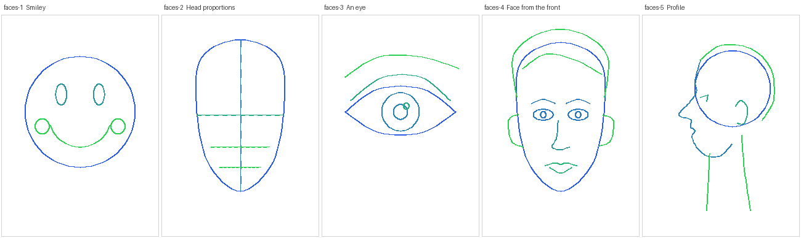
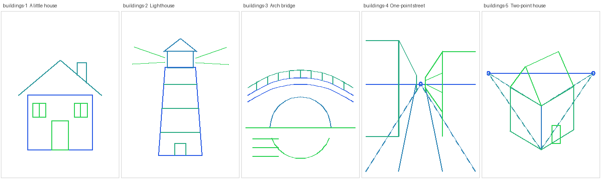
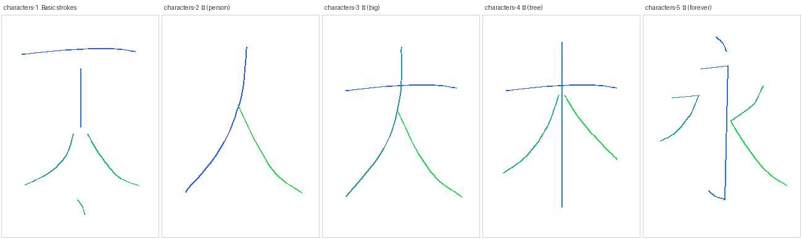

## 安装

从 [Release](https://github.com/kejing-dev/TraceLight/releases) 下载 `TraceLight-v0.2.0.apk`，头显用 USB 连电脑：

```bash
adb install -r TraceLight-v0.2.0.apk
pico-cli app launch io.embodit.tracelight
```

## 怎么用

1. 把纸平放在桌上（胶带粘两个角更稳），打开「透写台」，点「准备好了」，低头看桌面。
2. 看着纸捏一下，放下纸框；把 ①②③④ 四个角拖到纸角，点「对好了」。
3. 在课程库里选一套、选一张；跟着蓝线描，点「下一步」出现下一笔，最后「画完了」。
4. 「⋯」里可以重新对齐、自由画、回目录。

## 已知问题 / 待确认

- 本版没有走单独的 QA 站，只做了研发自检（编译、14 个单元测试、无 Material、头显启动 71 秒无崩溃、模拟器全流程截图）；用户已在真机上看过并同意发布。
- 纸被碰动后线不会自动跟着走：点「⋯ → 重新对齐」，在原处会自动吸附到上一次的位置。
- 键盘、笔记本等比桌面高的平面会被识别成「桌面」；纸框高度取纸下面的 TABLE 平面，桌面识别错时线可能浮在纸上方几毫米。
- 模拟器启动器里的图标显示没有核对（应用内图标资源与 512 导出已核对）。
- 调试版（debug 签名）。

## 技术

Kotlin · PICO Spatial SDK 6.1.9 · 一个 Mixed Stage（Full Space，透视）· 平面检测 + 世界锚点 · SpatialUI + PicoTheme（无 Material）· ECS 绘制引导线。代码导览见 [AGENTS.md](AGENTS.md)。

---

## English

Lay a sheet of paper on your desk and line a virtual frame up with its four corners; pick a drawing and its guide lines appear on your own paper step by step — you trace them with a real pencil. For PICO OS 6 (Swan).

### What it does

- **Any sheet**: A4, Letter, a sticky note, a sketchbook page. Pinch to drop the frame, drag its four corners onto the paper's corners (the middle handle moves the whole frame, the controller stick turns it), tap **Aligned** and start drawing.
- **6 sets × 5 drawings, easy to hard**: line warm-ups · simple animals · plants and flowers · faces · buildings · Chinese strokes.
- **Step by step**: the current step is bright blue, earlier steps fade, later ones are not shown yet; an orange dot draws the step in stroke order.
- **Free draw**: the whole sheet is yours, with an optional 20 mm grid.
- **Gaze + pinch** or **controller ray + trigger**; the panel stands left of the sheet (right for left-handers), within reach from your chair.
- Offline, no account, no network, no camera permission; Chinese and English.

### Screenshots

Screenshots are from the PICO emulator (virtual room, desk made by a debug command) — not headset captures and not a real hand recording. See the table above.

### Install

Download `TraceLight-v0.2.0.apk` from [Releases](https://github.com/kejing-dev/TraceLight/releases), connect the headset over USB:

```bash
adb install -r TraceLight-v0.2.0.apk
pico-cli app launch io.embodit.tracelight
```

### Known issues

- This version skipped the separate QA station: developer self-checks only (build, 14 unit tests, no Material, 71 s on the headset without a crash, full emulator walkthrough); the owner checked it on the headset and approved the release.
- If the paper is bumped the lines don't follow: use **⋯ → Re-align the paper** (it snaps back onto the previous spot).
- Keyboards and laptops can be detected as desk planes; the frame takes its height from the TABLE plane under it, so a misdetected desk can leave lines a few millimetres above the paper.
- The launcher icon was not checked on the emulator. Debug-signed build.

### Tech

Kotlin · PICO Spatial SDK 6.1.9 · one Mixed Stage (Full Space, passthrough) · plane detection + world anchors · SpatialUI + PicoTheme (no Material) · guide lines drawn as ECS meshes. Code tour: [AGENTS.md](AGENTS.md).
