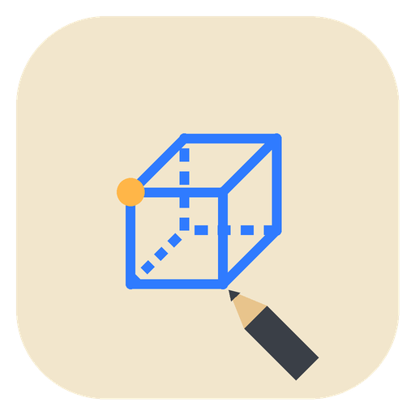
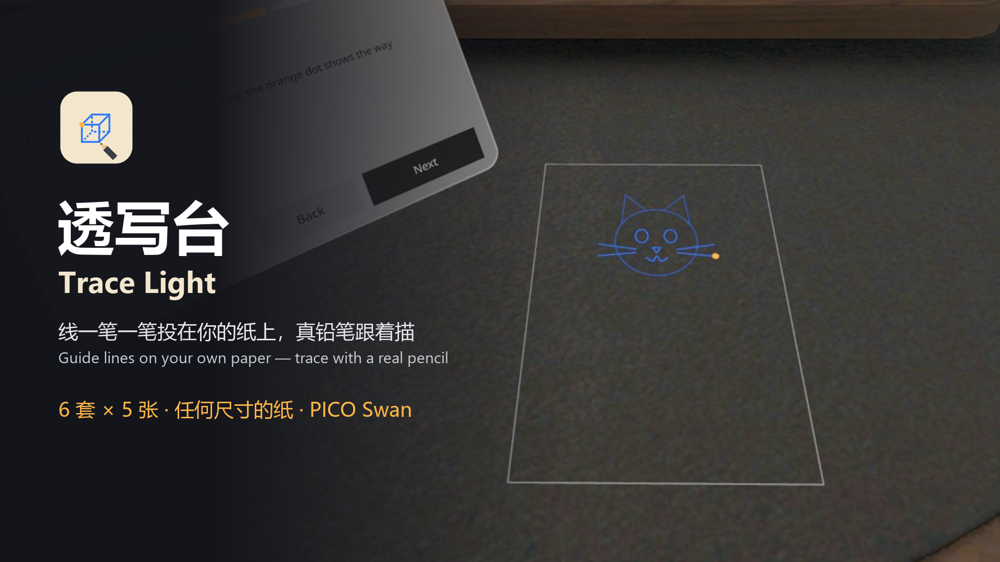

# 家具试摆 Furniture Fit



1.6 米的沙发放得下吗？在家具库里点一下，它就按 1:1 落在你家地板上；按住拖到墙边会自动贴上，四边拉出黄色卷尺，告诉你还剩几厘米、人走不走得过去。撞到墙、别的家具或真实家具时变红，挡住门变橙。PICO OS 6 的 MR 应用，只在 Full Space 里运行。

Will a 1.6 m sofa fit? Tap a tile and the piece lands 1:1 on your real floor. Hold and drag it to a wall and it snaps flush; yellow tapes on every side read the clearance left, so you can tell whether people can still walk past. It turns red when it goes into a wall, another piece or real furniture, and orange when it blocks a door. An MR app for PICO OS 6, Full Space only.



> **当前状态 / Status (v0.1.0)**
>
> - 只在 PICO 6.1 模拟器上验证过，还没在真机上跑过。**家具在真实房间里的落点精度没有在真机上验证。** Verified on the PICO 6.1 emulator only; not yet run on a headset. **Placement accuracy in a real room has not been checked on a device.**
> - 有 3 个已知问题（见下文「已知问题」），这一版没有修。There are 3 known issues (see below), not fixed in this version.
> - 截图和视频都来自模拟器，由调试命令和模拟器输入驱动，**不是真实手势录像**。Screenshots and video come from the emulator, driven by debug commands and injected emulator input. **This is not a recording of real hand gestures.**

## 截图 Screenshots

| | |
| --- | --- |
|  |  |
| **点格子放下**：双人沙发 1:1 落在视线前方地板上并选中，黄边框 + 件条，卷尺读出到旁边的净距 66 cm。Tap a tile: the loveseat lands on the floor, selected, with a 66 cm clearance tape. | **拖动中**：撞到真实的植物时整件实时变红，地上画出红色虚线。Dragging: it turns red the moment it touches the real plant. |
|  |  |
| **贴墙**：拖到墙边自动贴上，其余几边仍有卷尺，件条显示「放得下」。Snapped to the wall; the other sides still show tapes. | **挡门**：门前 0.8 m 出现橙色区域，件条显示警告。Blocking a door: an orange zone in front of the door and a warning on the strip. |
|  |  |
| **改尺寸**：宽 / 深 / 高三行 + 数字键盘，按自家家具的实际尺寸改。Resize: width, depth and height with a keypad. | **线框外观**：只留白色边框，看得见后面的房间。Wireframe look: only the edges, so you see the room behind. |

演示视频 Demo video: [docs/media/TraceLight-demo.mp4](docs/media/TraceLight-demo.mp4)（57 s，PICO 模拟器，调试输入驱动，无声，**非真实手势录像** / emulator, debug-driven, silent, not real gestures）：放沙发 → 拖动 → 贴墙 → 撞墙变红 → 改尺寸 → 线框 → 更多菜单 → 12/12。

## 怎么用 How it works

1. 打开应用，慢慢看一圈房间，等地板和墙被识别出来。Open the app and look around until the floor and walls are found.
2. 家具库有 11 个格子：三人沙发、双人沙发、单人椅、双人床、单人床、餐桌、书桌、书柜、衣柜、电视柜、自定义。点一个，它就落在你前方约 1.4 m 的地板上。The library has 11 tiles (sofas, beds, tables, storage, custom). Tap one and it lands about 1.4 m ahead.
3. 按住家具拖动；靠近墙会自动贴上。选中后件条可以转 90°、改尺寸、删除。Hold and drag; it snaps to walls. The strip rotates by 90°, resizes and removes.
4. 四边的黄色卷尺显示净距：≥ 80 cm 是绿点（人走得过去），5–80 cm 橙底。The tapes show the clearance: green dot from 80 cm, orange from 5 to 80 cm.
5. 红 = 撞了（墙、别的家具、空间网格识别出的真实家具）；橙 = 挡门。Red = collides; orange = blocks a door.
6. 摆法自动保存在本机：一个房间锚点 + 每件家具的相对位置。下次在同一个房间打开，家具从地板上升起回到原位。最多 12 件。The layout is saved on the headset (one room anchor plus local poses) and comes back next time in the same room. Up to 12 pieces.

全程离线，不联网，不需要账号或 API key。中文 / 英文界面，厘米 / 英寸单位。Fully offline, no account, no API key. Chinese and English; cm and inches.

## 安装 Install

```bash
adb install -r TraceLight-v0.1.0.apk
pico-cli app launch io.embodit.tracelight
```

APK 在 [Releases](../../releases) 里（debug 签名）。The APK is attached to the release (debug-signed).

## 构建 Build

```bash
./gradlew assembleDebug
adb install -r app/build/outputs/apk/debug/app-debug.apk
```

Needs the PICO Spatial SDK 6.1.9 (`PICO_HOME`) and JDK 21. 30 JVM tests: `./gradlew testDebugUnitTest`.

## 已知问题 Known issues (v0.1.0)

QA 第 1 轮发现 3 个实现问题，这一版先发布、没有修：
QA round 1 found 3 implementation defects. This version ships with them:

1. **英文「不可用」对话框标题被截断**（S20）。英文标题只显示 "Spatial features"，后面的 "unavailable" 被裁掉；中文「空间能力不可用」完整。原因：`Overlays.kt:189` 标题 `maxLines = 1`。The English "Spatial features unavailable" dialog title is cut to "Spatial features" (`maxLines = 1` at `Overlays.kt:189`). The Chinese title is fine.
2. **低头时提示条不在视野里**（S19 等所有提示条）。低头约 37° 时，提示条仍按水平视线摆放，在视线上方约 51°，看不到。原因：`FitScene.kt:593` 的 `restAt` 用了 `h.level()`。When you look down about 37°, the hint bar is still placed relative to the level gaze and stays out of view (`restAt` uses `h.level()` at `FitScene.kt:593`).
3. **定位丢失时，撞了的家具发粉**（S19）。定位丢失时家具应整体变灰，但判定为「撞了」的那件还留着 35% 红色罩，看起来是粉红色。原因：`PieceView.look` 里 `fillError` 没有判断 stale。When tracking is lost, a piece judged as colliding keeps its 35 % red overlay over the grey, so it looks pink (`fillError` in `PieceView.look` ignores stale).

## 真机待验 To check on a headset

1. 真实房间里家具 1:1 落地的位置精度（模拟器没有相机画面，地板高度和墙面位置只能信平面检测的数值）。Placement accuracy on a real floor.
2. 贴墙吸附在真实墙面上的贴合度（±5 cm），以及贴墙那一侧的黄色短条在真机上看不看得到。Wall snapping within ±5 cm, and whether the contact bar is visible.
3. 空间网格认出的真实家具（沙发、床、柜子）占地框和实物对不对得上；模拟器房间里没有沙发 / 桌子语义。Footprints of real furniture from the spatial mesh.
4. 门前 0.8 m 区域在真实门上的位置；模拟器只有 1 扇门。The door zone on real doors.
5. 重启后找回摆法（S15）和换房间（S16）在真机定位上的表现，10 s 超时是否合适。Restoring a layout and the other-room case, including the 10 s timeout.
6. 低头 45° 时家具库挡住多少地板。How much floor the library hides when you look down 45°.
7. 玻璃面板（家具库、件条、菜单、对话框、提示条、引导气泡）冷启动和快速开关时有没有黑块。Black patches on glass panels at cold start and fast open/close.
8. 平面识别 / 空间锚点在真机上是否要运行时授权，不可用对话框（S20）能否正确出现。Runtime permission for plane detection and anchors; the S20 dialog.
9. 真实手势（捏合点选、按住拖动）的手感和跟手延迟。Feel and latency of real pinch and drag.

## 技术 Tech

- PICO Spatial SDK 6.1.9, Kotlin. One Mixed Stage (passthrough), Full Space only. All 2D UI is SpatialUI (`com.pico.spatial.ui.*`) inside `PicoTheme`; no Material.
- Room sensing: `PlaneTrackingManager` (floor, walls, doors, cabinet sides as thin slabs) and `MeshTrackingManager` (per-vertex semantics clustered into real furniture boxes); `WorldTrackingManager` for one room anchor.
- Fit rules in pure Kotlin (`domain/Fit.kt`): collision (SAT on the floor plane), door zones, gaps, snap, push-out, rotate; covered by JVM tests.
- Per-frame work (drag, live snap and colours, gap tapes, lazy follow) runs in one ECS system (`FitScene.onFrame`), not in Compose.
- Furniture looks are basic shapes (≤ 12 boxes per piece), no model files.

## 文档 Docs

- [design/design-package.json](design/design-package.json), [design/sample.html](design/sample.html): the accepted design package (states S1–S22, rules, panels, palette, copy) and the approved sample.
- [AGENTS.md](AGENTS.md): guidance for coding agents (structure, debug commands, QA screenshot list, emulator facts). Paths there that start with `../spatial-app-factory` point to the factory workspace and are not in this repo; the same files are in `design/`.

## 字体 Font

Bundled fonts Noto Sans and Noto Sans SC (subset): SIL Open Font License (`third_party/`).
